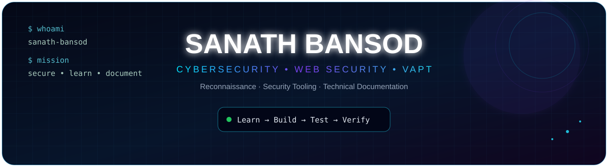
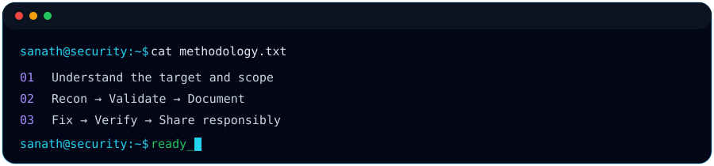
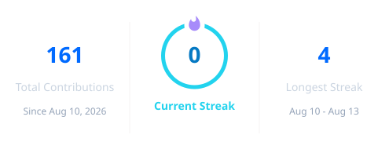

<div align="center">



<br>

<a href="https://github.com/SanathBansod"></a>
<a href="https://www.linkedin.com/in/sanathbansod53/"></a>


### `RECONNAISSANCE  /  VALIDATION  /  DETECTION  /  HARDENING`

</div>


## 👨‍💻 About Me

> **Aspiring Cybersecurity Professional** focused on learning how systems can be assessed, monitored, and secured.
>
> My portfolio brings together authorized web and network security labs, small Python tooling, detection exercises, SIEM investigations, and AWS IAM practice. I aim to document not just the steps, but also the evidence, limitations, and security takeaways.

<div align="center">

</div>

## 🧭 Technical Areas

| Field | Topics and tools represented in my projects |
|---|---|
| 🌐 **Web Application Security & Recon** | HTTP/HTTPS metadata, security headers, DNS, Certificate Transparency, crawling, forms, query parameters, JavaScript endpoint hints, API documentation discovery; **SpectraRecon**, ParamSpider, PortSwigger labs (learning) |
| 🔎 **Network Discovery & Enumeration** | Host discovery, port scanning, service enumeration, target connectivity; **Nmap** |
| 🧪 **Vulnerability Assessment & Penetration Testing** | Lab scope, vulnerability identification and validation, controlled exploitation, Meterpreter sessions, post-exploitation enumeration, evidence and remediation; **Metasploit Framework** |
| 🛡️ **Network Security & IDS** | Packet/traffic monitoring, custom detection rules, ICMP alerts, port-scan detection, SSH brute-force alerting; **Snort IDS**, Wireshark (learning/practice) |
| 📊 **SOC, SIEM & Log Analysis** | SSH authentication events, failed/successful logins, source IP analysis, targeted accounts, SPL queries, detection triage and investigation; **Splunk** |
| ☁️ **Cloud Security & IAM** | Root-account MFA, authenticator-app enrollment, IAM users, permissions review, least privilege, verification evidence; **AWS IAM** |
| 🐧 **Linux, Python & Tooling** | Kali Linux, CLI workflows, virtual environments, dependency troubleshooting, Python CLI development; **Python**, Git, GitHub |
| 📝 **Documentation & Reporting** | Reproducible steps, screenshots, structured Markdown/JSON/CSV reports, lab notes, limitations and next steps |

> **Skills note:** the table describes topics and tools represented in personal projects or learning. It is not a claim of expert-level proficiency or professional certification.

## 🎯 What I’m Working On

- Strengthen networking, DNS, HTTP, Linux, and Python fundamentals.
- Continue web-security labs and improve vulnerability validation and remediation writing.
- Improve Splunk queries, detection logic, event correlation, and investigation reports.
- Build and test security tooling with clear scope, output formats, and reproducible examples.
- Practice AWS identity hardening and independently verify the final security state.

---

## 🚀 Projects & Practical Labs

### 🖥️ Operating Systems & SOC Practical Guides

| Project / Guide | What it covers |
|---|---|
| [**Kali Linux & Windows File System — Complete Guide**](projects-practical-labs/kali-linux-windows-filesystem-password-storage.md) | Beginner-friendly side-by-side file-system trees, important directories, paths, file types, Linux permissions, Windows NTFS ACLs, practical commands, storage and mounts, logs, SOC investigation workflow, and safe labs. Includes password-related storage such as Linux `/etc/passwd`, `/etc/shadow`, `/etc/gshadow`, Windows SAM/SYSTEM/SECURITY, Active Directory `NTDS.dit`, and common password-hash/credential types. |
| [**Kali Linux Commands — Complete Practical Guide**](projects-practical-labs/kali-linux-all-commands-complete-guide.md) | A simple-English handbook covering terminal basics, files, search, permissions, users, processes, storage, APT, networking, DNS, SSH, logs, SOC investigation, Bash scripting, safe labs, troubleshooting, and interview questions. |
| [**Wazuh FIM + Windows Sysmon — SOC Lab Guide**](projects-practical-labs/wazuh-fim-windows-sysmon-soc-lab.md) | Step-by-step lab plan for Wazuh agents, file-integrity monitoring, Windows Sysmon telemetry, event forwarding, false-positive review, investigation notes, and evidence capture. Run the tests and add your own screenshots before claiming detections as completed. |


### 🌐 Web Security & Reconnaissance

| Project | What it covers |
|---|---|
| [**SpectraRecon**](https://github.com/SanathBansod/SpectraRecon) | Python-based reconnaissance for authorized targets, including HTTP metadata, DNS/Certificate Transparency lookups, same-origin crawling, forms and parameters, JavaScript endpoint hints, API documentation discovery, and Markdown/JSON reports. |
| [**ParamSpider Kali Setup**](https://github.com/SanathBansod/ParamSpider-Kali-Setup) | Kali Linux setup notes covering virtual environments, dependency troubleshooting, usage, and verification. |

### 🔎 Network Scanning & Enumeration

| Project | What it covers |
|---|---|
| [**Nmap Network Scanning**](https://github.com/SanathBansod/Nmap-Network-Scanning) | Practical network reconnaissance and service enumeration in an authorized Metasploitable lab. |

### 🧪 Vulnerability Assessment & Penetration Testing

| Project | What it covers |
|---|---|
| [**Metasploit Vulnerability Assessment**](https://github.com/SanathBansod/Metasploit-Vulnerability-Assessment) | Metasploitable 2 lab covering connectivity, service enumeration, finding validation, controlled exploitation, evidence, impact, and remediation. |
| [**Metasploit Bind & Reverse Shell Lab**](https://github.com/SanathBansod/Metasploit-Bind-Reverse-Shell) | Lab learning on msfvenom payloads, Multi/Handler, Reverse TCP, Bind TCP, Meterpreter, and controlled post-exploitation enumeration. |

### 🛡️ Network Security & Intrusion Detection

| Project | What it covers |
|---|---|
| [**Snort IDS**](https://github.com/SanathBansod/Snort-IDS) | Snort installation/configuration, custom rules, ICMP detection, port-scan alerts, SSH brute-force detection, and alert analysis in an authorized lab. |

### 📊 SOC, SIEM & Security Monitoring

| Project | What it covers |
|---|---|
| [**Splunk SSH Authentication Security Monitoring**](https://github.com/SanathBansod/splunk-ssh-authentication-security-monitoring) | SPL searches over educational SSH logs to review failed/successful logins, source IPs, targeted accounts, suspicious patterns, and investigation evidence. |
| [**Splunk Installation on Kali Linux — SOC & SIEM Guide**](projects-practical-labs/splunk-installation-kali-linux-soc-siem-security-monitoring.md) | Detailed simple-English guide to install and start Splunk, ingest sample logs, learn SPL, troubleshoot common issues, and practise beginner SOC investigations and security monitoring in a local lab. |

### ☁️ Cloud Security & Identity Access Management

| Project | What it covers |
|---|---|
| [**IAMForge — AWS Identity Lab**](https://github.com/SanathBansod/iamforge-aws) | Root-account MFA hardening, separate IAM user lifecycle, permission review, verification screenshots, and follow-up hardening checklist. |
| [**AWS IAM MFA Guide**](https://github.com/SanathBansod/aws-iam-mfa-guide) | Step-by-step MFA configuration with an authenticator app, screenshots, and reminders to protect credentials and MFA seed material. |

---

## 🧪 How I Approach a Lab

```text
1. Define scope and authorization
                 ↓
2. Understand the target or dataset
                 ↓
3. Run controlled tests or queries
                 ↓
4. Collect evidence and observations
                 ↓
5. Validate results and limitations
                 ↓
6. Document impact, recommendations, and next steps
```

## 📈 GitHub Activity & Languages

<div align="center">

<a href="https://github.com/SanathBansod">
  
</a>
<a href="https://github.com/SanathBansod">
  
</a>

<br><br>



</div>

## 📚 Next Steps

- [ ] Strengthen TCP/IP, DNS, HTTP, TLS, and networking fundamentals.
- [ ] Improve Linux commands, permissions, processes, services, and Bash skills.
- [ ] Build Python fundamentals and add automated tests to personal tools.
- [ ] Keep documenting PortSwigger labs with root cause, impact, and mitigation.
- [ ] Expand Splunk queries, alerting, event correlation, and SOC-style reports.
- [ ] Add clear installation, usage examples, screenshots, limitations, and test evidence to projects.

## 🤝 Connect

<div align="center">

<a href="https://www.linkedin.com/in/sanathbansod53/"></a>
<a href="https://github.com/SanathBansod"></a>

<br><br>

### `Learn → Build → Test → Verify → Document`

<sub>Security testing shown here is intended for authorized labs, educational environments, and responsible security research.</sub>

</div>
